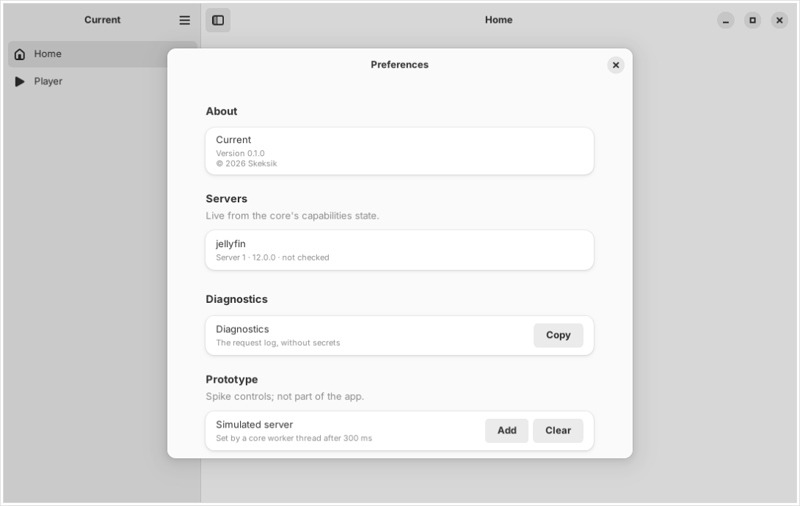
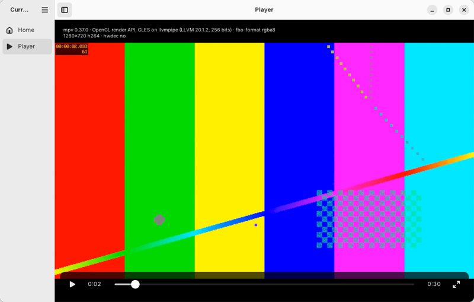
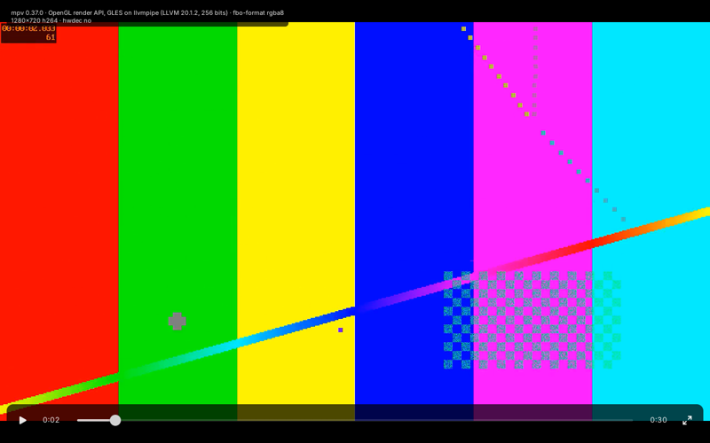

# D8 spike notes: Linux (GTK4 + libadwaita, libmpv in a GtkGLArea) (2026-10-22)

Decision: ADR 0011. This file records what was built, what ran where, the results, the research and the hands-on checks left for the
owner. Everything here ran **headless in a Linux cloud container with software OpenGL** (Mesa llvmpipe). Nothing ran on a GPU, a
real display, GNOME or KDE yet.

## What was built
A throwaway prototype, `apps/linux` (on the spike branch only; removed before merge). It is its own Cargo workspace, so the root
workspace, its lockfile, cargo-deny and CI never saw it.

- **Crates (approved for the prototype only, 2026-10-22):** `gtk4 =0.11.5` (feature `v4_14`), `libadwaita =0.9.2` (feature `v1_5`),
  both MIT, plus the already approved `tokio =1.54.1`. glib and gio come re-exported by gtk4. libmpv is called through about 20
  hand-written FFI declarations (`src/mpv.rs`, the only `unsafe` code, allowed in that module with a comment), linked against the
  system `libmpv.so.2`. There is no GL loader crate: GL functions come from `eglGetProcAddress`. The LGPL-2.1 `libmpv2` crate was not
  used, because it would be statically linked Rust code.
- **Window:** `adw::ApplicationWindow` > `adw::ToastOverlay` > `adw::OverlaySplitView`.
  - The sidebar is an `adw::ToolbarView` with an `adw::HeaderBar` and a `navigation-sidebar` list (Home, Player). The content is an
    `adw::ToolbarView` with a header bar and an `adw::ViewStack`.
  - A breakpoint (`max-width: 600sp`) collapses the sidebar into an overlay, and a header button toggles it.
  - Settings and About are not sidebar entries, unlike on Windows. They sit in the primary menu as Preferences (Ctrl+,, an
    `adw::PreferencesDialog`) and About Current (`adw::AboutDialog`), where GNOME apps put them (ADR 0001: native behaviour).
- **Core:** one `current_app::App` and one tokio multi-thread runtime (2 workers named `core-worker`) owned by the app, as
  `current-ffi` owns its runtime (ADR 0004). There is no bridge.
  - Subscriptions await the core's `tokio::sync::watch` receiver directly in a future on the GLib main context
    (`glib::spawn_future_local`): the current value first, then every change, and a slow consumer skips intermediate values. This is
    ADR 0004's value watch without UniFFI.
  - tokio's channels need no tokio runtime to be awaited, so there is no extra channel or thread hop, and the main loop never blocks.
  - A prototype-only "Add" button sets a simulated server from a core worker thread after 300 ms. Home and Preferences update live.
- **Player:** a `gtk::GLArea` (auto-render off) with libmpv's render API (`vo=libmpv`, `MPV_RENDER_API_TYPE_OPENGL`, `hwdec=no`,
  SDR), and GTK controls over the video in a `gtk::Overlay`.
  - The controls are play/pause, a seek `gtk::Scale` (user changes only, through `change-value`), position and duration labels, and
    a full-screen button.
  - They auto-hide after 3 s of no pointer movement while playing, together with the pointer.
  - Keys: Space/K play or pause, Left/Right seek 5 s, F or F11 toggles full screen, Escape leaves it. Double-click toggles full screen.
  - Full screen hides the sidebar and the header bar.
  - An info line shows the mpv version, the GL API and renderer, `fbo-format`, the video format and `hwdec-current`.
  - mpv's wakeup and update callbacks only notify a `tokio::sync::Notify`. Two main-loop futures await them: one drains mpv's events
    into the controls, the other calls `queue_render`. Rendering happens in the GLArea's `render` signal: `mpv_render_context_render`
    into the GLArea's bound framebuffer (`GL_FRAMEBUFFER_BINDING`), at the widget size times the scale factor, with `FLIP_Y`.
  - The render context is created on `realize` and freed on `unrealize` (with the context current). mpv is destroyed on close.
- **mpv needs `LC_NUMERIC=C`.** client.h: "The LC_NUMERIC locale category must be set to \"C\"". GTK sets the user's locale at
  start-up, so the app resets the numeric category before creating mpv.
- **Test clip:** `make-test-clip.sh` makes a synthetic 30 s 1280x720 30 fps H.264 clip (ffmpeg `testsrc2` and a 440 Hz sine tone).
  It used the distro ffmpeg, a GPL build with libx264. The clip and the tool are local only, never shipped or checked in (approved
  for the local clip, 2026-10-22).
- **Screenshot mode:** `--screenshot <dir>` walks Home, Preferences (with a simulated server), the player (light, dark, narrow,
  full screen), saves each state with `gtk::WidgetPaintable` and the window's GSK renderer, then quits. `--mpv name=value` passes
  options to mpv.

## Where it ran
| What | Version |
|---|---|
| OS | Ubuntu 24.04.5 LTS (cloud container, no GPU, no D-Bus session bus) |
| GTK / libadwaita | 4.14.5 / 1.5.0 (Ubuntu packages) |
| libmpv | 0.37.0 (Ubuntu `libmpv2` 0.37.0-1ubuntu4, client API 2.2), FFmpeg 6.1.1 |
| Mesa | 25.2.8 (llvmpipe, LLVM 20.1.2) |
| X11 | Xvfb 21.1.12, no window manager |
| Wayland | weston 13.0.0, `--backend=headless --renderer=gl` |
| Rust | 1.99.1 (the pinned toolchain) |

## Results
### Build and checks
- `cargo build`, `cargo clippy --all-targets -- -D warnings`, `cargo fmt --check` and `cargo test` pass in `apps/linux`.
- `cargo deny --config ../../deny.toml check` in `apps/linux` gives "advisories ok, bans ok, licenses ok, sources ok". Every crate in
  the gtk-rs tree is MIT, Apache-2.0, Unlicense-or-MIT or Apache-2.0 WITH LLVM-exception. This was a one-off check, not a merge gate.
- The root workspace's CLAUDE.md commands pass, unaffected by the prototype.

### Window and core (Xvfb and weston, headless)
- The window, sidebar, header bars, Preferences dialog, About dialog, light and dark styles, and the narrow breakpoint render as
  expected.
- Capabilities set from a core worker thread show up on Home and in Preferences within the next main-loop iteration.
- Full screen works under weston (sidebar and header bar hidden, controls over the video). Under Xvfb, `fullscreen()` does nothing,
  because there is no window manager.
- Under weston, `set_default_size` on a mapped window does not resize it, so the "narrow" case was only seen under Xvfb.
- Under weston the sidebar came out 126 px wide, so its title shows as "Curr…" in the Wayland screenshots. That happened even after
  the prototype set `min-sidebar-width` to 200 (`AdwOverlaySplitView`'s default minimum is 180). Under Xvfb it is 268 px. Not
  understood; case 3 below checks it in WSLg.



### Video in the GtkGLArea
mpv renders decoded frames into the GLArea on both X11 (Xvfb) and Wayland (weston), with GTK's default OpenGL ES context and with
desktop GL. Orientation is right with `FLIP_Y=1`. Seek, play and pause, the time labels and the overlay controls work, and mpv reports
30 frames per second rendered.




On llvmpipe the picture itself was unreliable in three ways. All three are runs on software GL in this container, not evidence about
GPUs:

1. **Black video for a whole run, in about half of the runs.** This happened with mpv's default intermediate framebuffer format
   (`rgba16f`) on X11 and Wayland, with GLES and desktop GL.
   - GTK's side was ruled out: clearing the GLArea to a colour that changes after 10 frames showed every change on screen in 6 of 6
     runs.
   - A pixel read back right after `mpv_render_context_render` was `[0,0,0,255]` in black runs and the clip's colours in good runs,
     so mpv itself drew black.
   - Disabling mpv's shader cache, `vd-lavc-dr=no`, `opengl-early-flush`, `opengl-glfinish` and `gpu-hwdec-interop=no` did not help.
   - **`fbo-format=rgba8` fixed it:** 8 of 8 runs on X11, then 16 of 16 across X11 and Wayland with the automatic fallback below.
     Forcing `rgba16f` again brought back a black run (1 of 6).
   - The prototype now sets `fbo-format=rgba8` when `GL_RENDERER` names llvmpipe, softpipe or swrast. This is the ADR 0007 pattern:
     the UI reports a fact (here, the renderer) and options are chosen from it.
   - Not reproduced with mpv's own window (`vo=gpu`, 640x360, 6 of 6 fine). The root cause was not found.
2. **Green picture (chroma lost):** 2 of 8 runs on X11 and 5 of 8 on Wayland with the fallback on.
   - This also happens in mpv's own window with no GTK at all (`vo=gpu`, `gpu-context=x11egl`, `fbo-format=rgba8`): 7 of 8 runs.
   - So it is mpv 0.37 on Mesa 25.2 llvmpipe, not the GLArea integration.
3. **Striped or green downscales** when the window is narrow (1280x720 into 290x163), in most runs, under both GL APIs.
   - mpv's own window shows the same at that size (2 of 3 runs).
   - `dscale=bilinear` helped in one run, not reliably.

Other observations:
- **GTK 4.14 picks OpenGL ES 3.2** for the GLArea by default (GDK's log: "Creating EGL context version 2.0 (... es:yes)";
  mpv: "Detected GLES 3.2"). That matches GTK's NEWS for 4.13.4: "Use GLES by default". mpv works on GLES. `CURRENT_SPIKE_GL=gl` makes the
  prototype ask for desktop GL, and mpv then reports "4.5 (Core Profile)".
- **mpv leaves framebuffer 0 bound** after `mpv_render_context_render`; GTK's own FBO is no longer bound. Rebinding it afterwards
  was inconclusive: before the `rgba8` fallback, on-screen video showed in 3 of 6 runs with the rebind and 2 of 6 without, while
  in-app snapshots showed video in 5 of 6 with it and 0 of 6 without. M5 should rebind it, because it is cheap and GTK may expect it.
- mpv logs "Suspected software renderer or indirect context" on llvmpipe, and "mpv_render_context_render() not being called or stuck"
  once at start in some runs. Harmless here.
- The `gtk::WidgetPaintable` snapshot of the window sometimes returned no render node, or a different picture from the screen. Screen
  grabs (`ffmpeg -f x11grab`, `weston-screenshooter`) were used to judge what a user would see; the in-app snapshots only for the
  screenshots shown here.
- Without a D-Bus session bus, GTK warns "Unable to acquire session bus". MPRIS, portals and the keyring could not be tried here.

### Minimum versions and packages (state as requirements, not Ubuntu packages)
| Need | Minimum | Why |
|---|---|---|
| GTK | 4.14 | gtk4-rs feature `v4_14`; `GtkGraphicsOffload` (for a later HDR path) is "Since: 4.14" |
| libadwaita | 1.5 | libadwaita-rs feature `v1_5`: `AdwOverlaySplitView`, `AdwToolbarView`, `AdwBreakpoint` (1.4), `AdwPreferencesDialog`, `AdwAboutDialog` (1.5) |
| libmpv | soname 2, mpv 0.35 or later | Client API 2.0 came with mpv 0.35.0 ("remove headers/functions of the obsolete opengl_cb API"). The render calls used here are unchanged up to 0.41 (below) |
| glibc | 2.34 for this build | Highest symbol version the debug binary built on Ubuntu 24.04 needs (`objdump -T target/debug/current-linux-spike \| grep -o 'GLIBC_[0-9.]*' \| sort -uV \| tail -1` gives GLIBC_2.34). A release binary must be built on the oldest glibc it supports and checked again |
| OpenGL | GL 3.x or GLES 3.x through EGL | What mpv's OpenGL renderer and GTK's GLArea use |

Development packages per distribution (the libraries the prototype links; the setup lines further down add the tools):
- Ubuntu 24.04: `libgtk-4-dev libadwaita-1-dev libmpv-dev` (installed and built here).
- Fedora: `gtk4-devel libadwaita-devel mpv-devel`. packages.fedoraproject.org, read 2026-10-22: Fedora 43 ships GTK 4.20.4,
  libadwaita 1.8.8 and mpv 0.40.0; Fedora 44 ships 4.22.5, 1.9.4 and 0.41.0. Not verified by running.
- Arch: `gtk4 libadwaita mpv`. archlinux.org, read 2026-10-22: gtk4 4.24.1, libadwaita 1.10.0, and mpv 0.41.0, which "Provides
  libmpv.so=2-64". Not verified by running.

### mpv 0.37 to 0.41: what the render calls depend on
From mpv's `DOCS/client-api-changes.rst` (master, read 2026-10-22):
- 0.38 (API 2.3): "remove libmpv as the default VO and move it to the bottom of the auto-probing order". The prototype sets
  `vo=libmpv` explicitly, so this does not affect it.
- 0.39 (API 2.4): `MPV_RENDER_PARAM_ICC_PROFILE` fixed.
- 0.40 (API 2.5): "Deprecate MPV_RENDER_PARAM_AMBIENT_LIGHT".
- 0.41: no entry.
- Unreleased 0.42 (API 2.6): "add MPV_RENDER_API_TYPE_D3D11 render API backend". There is no Vulkan render API.

Nothing changes `MPV_RENDER_PARAM_OPENGL_FBO`, `FLIP_Y`, the init parameters or the update callback. The prototype's calls should work
unchanged on 0.41, the version Windows uses. Not verified by running on 0.41.

## Research (sources read 2026-10-22)
### HDR on Linux
- **Wayland protocol.** `wp_color_management_v1` was merged into wayland-protocols' `staging/` (MR 14, merged 2025-02-13) and first
  released in wayland-protocols 1.41 (tagged 2025-02-17). It is still staging: the file says "Warning! The protocol described in this
  file is currently in the testing phase."
  (https://gitlab.freedesktop.org/wayland/wayland-protocols/-/raw/main/staging/color-management/color-management-v1.xml)
- **Compositors:**
  - Mutter NEWS: 48.rc "Support wp_color_management_v1 protocol". GNOME 48 release notes: "the initial introduction of system level
    HDR support", with "the new High Dynamic Range switch in the display settings" (https://release.gnome.org/48/).
  - KWin implements the upstream protocol from Plasma 6.4.0 (2025-06-12); 6.2 and 6.3 had earlier experimental ones.
  - wlroots 0.19.0 and later (0.20.0: "Full Vulkan renderer, backend and scene-graph support for color-management-v1"). Sway 1.12:
    "Add support for HDR10 when running with the Vulkan renderer".
  - Hyprland from v0.48.0. Weston 15.0.0 has it as "TENTATIVE, EXPERIMENTAL" and opt-in.
- **X11 has no HDR path.** Collabora (Pekka Paalanen, 2020-11-19): "even X11 has not gained support for HDR."
  (https://www.collabora.com/news-and-blog/blog/2020/11/19/developing-wayland-color-management-and-high-dynamic-range/) Nothing newer
  was found (not verified beyond that).
- **mpv:**
  - 0.40.0 added "wayland: add support for wp-color-management-v1 protocol".
  - 0.41.0 changed "--target-colorspace-hint to 'auto' by default" with "Improved default color management for gpu-next, and handling
    on Wayland".
  - `--target-colorspace-hint`: "Currently, this is supported on Wayland, D3D11 and winvk contexts ... Requires a supporting driver
    and `--vo=gpu-next`." mpv's Wayland EGL context also implements it (`video/out/opengl/context_wayland.c`, `set_color`), so Vulkan
    is not required. Read in the source, not tested.
  - https://github.com/mpv-player/mpv/releases, `DOCS/man/options.rst` (master).
- **The libmpv render API has no HDR output.**
  - `video/out/gpu/libmpv_gpu.c` drives the older `vo_gpu` renderer (`gl_video_init`), not `gpu-next`.
  - `render.h` (master) has no output colour space or HDR target parameter; the only colour one is `MPV_RENDER_PARAM_ICC_PROFILE`.
  - `MPV_RENDER_PARAM_DEPTH`: the renderer will "assume 8 otherwise" (outside D3D11).
  - So `target-colorspace-hint` does not apply to `vo=libmpv`, and the embedding app receives no HDR signalling. This is our reading of
    the source; mpv's documentation does not say it outright.
- **GTK:**
  - Colour states arrived in 4.16 (`GdkColorState`, `gdk_color_state_get_rec2100_pq` "Since: 4.16", a colour state on
    `GdkGLTextureBuilder` "Since: 4.16").
  - GTK uses the Wayland protocol, but opt-in. NEWS 4.18.1: "makes the use of the Wayland color-management protocol opt-in ... use
    GDK_DEBUG=color-mgmt". In 4.24.1, `gdk/wayland/gdkdisplay-wayland.c` still skips `wp_color_manager_v1` unless that debug flag is
    set. GTK blog, 2024-08-11: "Note that this doesn't make HDR content appear on your screen."
    (https://blog.gtk.org/2024/08/11/the-colors-of-gtk/)
- **GtkGLArea cannot carry HDR.** `gtkglarea.c` (4.24.1) always allocates `GL_RGBA8` textures with an 8-bit memory format and sets no
  colour state.
- **`GtkGraphicsOffload`** (since 4.14): "Bypasses gsk rendering by passing the content of its child directly to the compositor";
  "Currently, graphics offload only works on Linux with Wayland". It needs dmabuf textures without clipping, alpha or transforms.
  `gdk/wayland/gdksubsurface-wayland.c` passes the texture's colour state to the compositor (with colour management enabled).
  GStreamer's GTK4 sink builds `gdk::CicpParams` colour states for its dmabuf frames (gst-plugins-rs `video/gtk4/src/sink/frame.rs`).
  This is the only HDR-capable path in GTK we found. That it works end to end is not verified.
- **GTK's GL choices:** NEWS 4.13.4: "Use GLES by default" (with `GDK_DEBUG=gl-prefer-gl`). NEWS 4.3.1: "Support EGL for X11. Fall
  back to GLX if EGL isn't available". GtkGLArea's default allowed APIs are GL and GLES.

### Hardware decoding (mpv `DOCS/man/options.rst`, master; `render_gl.h`)
- `vaapi` "requires --vo=gpu, --vo=gpu-next, --vo=vaapi or --vo=dmabuf-wayland". With the render API it needs EGL plus the native
  display: "Intel/Linux: EGL is required, and also the native display resource needs to be provided (e.g. MPV_RENDER_PARAM_X11_DISPLAY
  for X11 and MPV_RENDER_PARAM_WL_DISPLAY for Wayland)". The app has to pass GDK's `wl_display`/`Display*`, which needs gtk-rs's
  `gdk4-wayland`/`gdk4-x11` crates (more crates, M5).
- `nvdec` "requires --vo=gpu or --vo=gpu-next". render_gl.h: "nVidia/Linux: Both GLX and EGL should work".
- `vulkan` "requires --vo=gpu-next", so it is not available to `vo=libmpv`.
- `vdpau` is under "Other hwdecs (only use if you know you have to)", and Mesa removed its VDPAU frontend (commit 4b54277d2e94,
  2025-09-10, gone from Mesa 25.3).
- For libmpv, interop loading "is equivalent to all": every interop is probed at start (seen in the log: vaapi, cuda, drmprime,
  vulkan).
- Nothing was tried here: the container has no GPU.

### MPRIS (media keys and the desktop's media controls)
- **Spec 2.2** (http://specifications.freedesktop.org/mpris/latest/): "Each media player must request a unique bus name which begins
  with org.mpris.MediaPlayer2."
  - The player exports `/org/mpris/MediaPlayer2` with `org.mpris.MediaPlayer2` and `org.mpris.MediaPlayer2.Player`.
  - Metadata "must have a "mpris:trackid" entry".
  - Seek and SetPosition are in microseconds, and the `Seeked` signal reports jumps.
- **Who reads it:**
  - GNOME Shell's `js/ui/mpris.js` (prefix `org.mpris.MediaPlayer2.`, uses `DesktopEntry` for the icon and name).
  - Plasma's `libkmpris` (watches `org.mpris.MediaPlayer2*`).
  - GNOME's media keys go through gnome-settings-daemon's MPRIS controller (`plugins/media-keys/mpris-controller.c`, calls
    `PlayPause` etc.).
- **In Flatpak** the default policy lets an app own `org.mpris.MediaPlayer2.$FLATPAK_ID`
  (https://docs.flatpak.org/en/latest/sandbox-permissions.html).
- **Rust:** gio's `DBusConnection::register_object` (gio 0.22, re-exported by gtk4) does it on the GLib main loop with no new crate.
  The alternative `mpris-server` 0.10.0 is MPL-2.0 (an ADR 0003 exception) and pulls in zbus 5.14, a second D-Bus stack; zbus 6.0.0
  came out 2026-10-16.

### Secret Service and the keyring (M1)
- Secret Service API 0.2 (draft) (https://specifications.freedesktop.org/secret-service/latest/). GNOME Keyring and KWallet provide
  it. KDE Frameworks 5.97.0 (2022-08-14): "Introduce Secret Service API". KWallet's README: "ksecretd exposes the Secret Service DBus
  API".
- **Secret portal** (`org.freedesktop.portal.Secret`): "allows sandboxed applications to retrieve a per-application secret ... used
  for encrypting confidential data inside the sandbox". libsecret switches to a portal-keyed local file keyring when it finds
  `/.flatpak-info` (`libsecret/secret-backend.c`).
- **`keyring` 4.2.0** (2026-08-29, MIT OR Apache-2.0, ADR 0002's candidate) uses the Secret Service over D-Bus (zbus) on Linux, not
  the portal. Inside Flatpak it would need talk access to `org.freedesktop.secrets`. Whether Flathub accepts that is not verified.
  The Flatpak choice (keyring crate with a hole in the sandbox, or the portal plus our own encrypted store) is open for M1/M5.

### Portals (https://flatpak.github.io/xdg-desktop-portal/docs/api-reference.html)
- The ones that matter for us: FileChooser, OpenURI, Inhibit ("inhibit the user session from ending, suspending, idling"; flag 8 =
  Idle, for playback), Settings (`org.freedesktop.appearance` `color-scheme`, `accent-color`, `contrast`, `reduced-motion`),
  Notification, Background, NetworkMonitor, GlobalShortcuts and Secret.
- GTK detects a sandbox itself (`gdk_running_in_sandbox`: Flatpak or Snap) and uses portals there. `GDK_DEBUG=portals` forces them.
  `gtk_application_inhibit` is GTK's API for idle inhibition.

### Accessibility (Orca)
- GTK 4 has its own accessibility model, `GtkAccessible`, with ARIA-like roles. Its backend on Linux is "AT-SPI on Linux/BSD"
  (https://docs.gtk.org/gtk4/section-accessibility.html).
- GTK 4.14 added a public AccessibleText interface and `gtk_accessible_announce()`
  (https://blog.gtk.org/2024/03/08/accessibility-improvements-in-gtk-4-14/).
- GTK 4.18 added an AccessKit backend, "but we are still defaulting to at-spi here"
  (https://blog.gtk.org/2025/05/12/an-accessibility-update/).
- The prototype labels the seek bar ("Position"), and its buttons have tooltips.
- Not tried with Orca: there is no session bus or AT-SPI here.

### WSL2 / WSLg (for the owner's hands-on run)
- WSLg "supports running Linux GUI applications (X11 and Wayland)" (Microsoft Learn, updated 2026-06-02,
  https://learn.microsoft.com/en-us/windows/wsl/tutorials/gui-apps). It runs Weston with XWayland
  (https://github.com/microsoft/wslg).
- GL is hardware accelerated through Mesa's d3d12 Gallium driver when the vGPU driver is installed. Mesa's d3d12 page says "full
  desktop OpenGL 3.3 support", while Mesa's `features.txt` lists d3d12 up to GL 4.6. What a given machine exposes is not verified.
- VA-API decode through d3d12 exists since 2023 (H.264, HEVC Main/Main10, VP9, AV1)
  (https://devblogs.microsoft.com/commandline/d3d12-gpu-video-acceleration-in-the-windows-subsystem-for-linux-now-available/).
  Whether mpv's vaapi interop works there is not verified.

### Packaging and licences (ADR 0003)
- **Ubuntu 24.04's FFmpeg is GPL.** `ffmpeg -version` here: "configuration: ... --enable-gpl ..." and "under the terms of the GNU
  General Public License". Debian's `debian/rules`: "Most possible features, compatible with effective licensing of GPLv2+".
- **Ubuntu's and Debian's libmpv is a GPL build.**
  - mpv's own log here shows "Configuration: ... -Dcdda=enabled -Ddvdnav=enabled ... -Ddvbin=enabled".
  - mpv 0.37's `meson.build` lets those features build only when GPL is on (`require(get_option('gpl'), error_message: 'the build is
    not GPL!')`), and `option('gpl', ..., value: true, ...)` is the default.
  - mpv 0.37 also gates its X11 backend the same way.
- **Fedora:** `ffmpeg-free` is `License: GPL-3.0-or-later` with `--enable-gpl --enable-version3`
  (https://src.fedoraproject.org/rpms/ffmpeg/raw/rawhide/f/ffmpeg.spec).
- **Arch:** its mpv package is labelled "GPL-2.0-or-later AND LGPL-2.1-or-later".
- **Flatpak:**
  - GNOME 51's runtime is built on freedesktop-sdk 26.08 (gnome-build-meta, branch gnome-51).
  - The base runtime's FFmpeg is "Base ffmpeg we ship in the SDK, no patented codecs": no `--enable-gpl` (LGPL, our reading), with
    H.264, HEVC, VC-1 and VVC decoders disabled.
  - Since 25.08, the `codecs-extra` extension replaces `ffmpeg-full` and is built with `--enable-libx264 --enable-libx265
    --enable-gpl` (freedesktop-sdk `elements/extensions/codecs-extra/ffmpeg.bst`). Its metainfo says LGPL-2.1, which contradicts the
    flags; treat it as GPL.
  - Flatpak apps built on mpv usually build their own libmpv in the manifest.
- **Flathub** requires that "All content hosted on Flathub must allow legal redistribution", with "extra-data" for non-redistributable
  sources (https://docs.flathub.org/docs/for-app-authors/requirements). A proprietary but redistributable app is not ruled out.
  Flathub's stance on proprietary apps beyond that page is not verified.
- **Conclusion (ADR 0011):** linking our proprietary app against the distro's libmpv or FFmpeg is not within ADR 0003 on Debian, Ubuntu
  or Fedora. A distributed Linux build needs our own LGPL-2.1 libmpv and FFmpeg, as on Windows (D6). The spike's use of the system
  libraries is fine because nothing is distributed.

## Hands-on checks for the owner (WSL2 with WSLg)
Assumed: Ubuntu 24.04 in WSL2, WSLg working (`echo $WAYLAND_DISPLAY` prints `wayland-0`), the vendor's WSL GPU driver on Windows.

Setup:
```
sudo apt update
sudo apt install -y build-essential curl git pkg-config libgtk-4-dev libadwaita-1-dev libmpv-dev ffmpeg mesa-utils
curl --proto '=https' --tlsv1.2 -sSf https://sh.rustup.rs | sh -s -- -y --default-toolchain none && . "$HOME/.cargo/env"
git clone https://github.com/skeksik/current-rs.git && cd current-rs && git checkout spike/linux-gtk
cd apps/linux && ./make-test-clip.sh && cargo run --release
```
(`rust-toolchain.toml` makes rustup install the pinned 1.99.1 on the first `cargo` call.)

On other distributions, replace the `apt` lines. The GTK, libadwaita and mpv package names are from packages.fedoraproject.org and
archlinux.org, read 2026-10-22 (versions above). The tool package names (compiler, pkg-config, ffmpeg, glxinfo) were not checked
against an index. Neither line has been run:
```
# Fedora (not verified by running)
sudo dnf install -y gcc git pkgconf-pkg-config gtk4-devel libadwaita-devel mpv-devel ffmpeg-free mesa-demos
# Arch (not verified by running)
sudo pacman -S --needed base-devel git gtk4 libadwaita mpv ffmpeg mesa-utils
```

| # | Case | What to look at |
|---|---|---|
| 1 | Build | `cargo run --release` builds without errors or warnings |
| 2 | GL driver | `glxinfo -B` and the player's info line: the renderer should name D3D12 and the GPU, not llvmpipe; note GL vs GLES and the version |
| 3 | Look and feel | The window looks like a GNOME app: header bars, sidebar, rounded corners, shadows. Primary menu: Preferences (Ctrl+,) and About. The sidebar title reads "Current" in full (it was cut to "Curr…" under weston) |
| 4 | Core state | Preferences > Prototype > Add: a "jellyfin" server appears within a second in Preferences and on Home; Clear removes it |
| 5 | Keyboard | Tab and arrows move through the sidebar and controls with a visible focus ring; Ctrl+, opens Preferences; Escape closes dialogs; Ctrl+W and Ctrl+Q close |
| 6 | Light/dark | Does the app follow Windows' dark mode on its own? (Probably not: WSLg has no settings portal; note what happens.) Then `ADW_DEBUG_COLOR_SCHEME=prefer-dark cargo run --release`: everything turns dark, the video area stays black |
| 7 | Video | Player: the test pattern plays with correct colours (red, green, yellow, blue, magenta, cyan bars), the timer at the top left counts, sound plays (WSLg's PulseAudio) |
| 8 | Controls | Play/pause button and Space; seek bar drag; Left/Right; controls and pointer hide after 3 s while playing and come back on movement |
| 9 | Resizing | Drag the window edge slowly and fast, maximize and restore: no black frames, stripes or stretched picture; narrow below 600 px folds the sidebar |
| 10 | Full screen | F11, the button, double-click: sidebar and header bar hide, video fills the screen; Escape or F11 returns. Several cycles |
| 11 | Compare GL APIs | `CURRENT_SPIKE_GL=gl cargo run --release`: same cases 7 to 10 with desktop GL |
| 12 | Software fallback check | If the info line shows `fbo-format rgba8` on the GPU, say so (it should show mpv's default) |
| 13 | X11 path | `GDK_BACKEND=x11 cargo run --release` (XWayland): cases 7 to 10 again |

Not verified, needs native Linux: HDR output (and whether GTK and mpv can carry it at all, ADR 0011), hardware decoding (VA-API, NVDEC),
MPRIS and media keys, the keyring (Secret Service, KWallet, the portal), portals in Flatpak, Orca, performance and frame pacing on a
real GPU, GNOME and KDE integration (fractional scaling, multiple monitors).

## WSL2 run (2026-10-22)
The hands-on checks above, run by the owner on a Windows PC: commands run by Claude, the owner judged everything visual.

| What | Version |
|---|---|
| Head commit | `65e9885` (spike/linux-gtk) |
| Windows | 10.0.26200 |
| WSL | 2.7.8.0, WSLg 1.0.73.2, kernel 6.18.33.1 |
| Distro | Ubuntu 24.04.5 LTS (the packages from the setup above, GTK 4.14.5, libadwaita 1.5.0, libmpv 0.37.0, Mesa 25.2.8) |
| GPU | NVIDIA GeForce RTX 5090 (the PC also has AMD Radeon integrated graphics) |
| GL renderer, out of the box | `llvmpipe (LLVM 20.1.2, 256 bits)` |
| GL renderer, forced | `D3D12 (NVIDIA GeForce RTX 5090)`, GL 4.6 core, with `GALLIUM_DRIVER=d3d12 MESA_D3D12_DEFAULT_ADAPTER_NAME=NVIDIA` |

**Mesa does not pick the GPU on its own here.** `/dev/dxg`, `/usr/lib/wsl/lib/libd3d12.so` and Mesa's `d3d12_dri.so` are all there,
but `glxinfo -B` and `eglinfo -B` (Wayland and X11) report llvmpipe, and the app logs `MESA: error: ZINK: failed to choose pdev`
before falling back to llvmpipe. `GALLIUM_DRIVER=d3d12` alone picks the first adapter (the integrated AMD GPU);
`MESA_D3D12_DEFAULT_ADAPTER_NAME=NVIDIA` picks the RTX 5090. So the run used these variants:

- **llvmpipe, Wayland**: out of the box, `cargo run --release`, for cases 2 and 7 only.
- **GPU, GLES, Wayland**: the default variant with the two variables above; cases 2 to 10 and 12.
- **GPU, GL, Wayland**: `CURRENT_SPIKE_GL=gl` with the two variables, plus `ADW_DEBUG_COLOR_SCHEME=prefer-dark` for case 6.
- **X11**: `GDK_BACKEND=x11`, on the GPU and then on llvmpipe, then with `GSK_RENDERER=cairo` as a diagnostic.

| # | Case | Result |
|---|---|---|
| 1 | Build | Pass: `cargo run --release` builds without errors or warnings. |
| 2 | GL driver | Fail out of the box (llvmpipe, see above; the info line names llvmpipe). Pass with the two variables: the info line names D3D12 (NVIDIA GeForce RTX 5090). |
| 3 | Look and feel | Pass (GPU, Wayland): header bars, sidebar, rounded corners, shadows. The sidebar title reads "Current" in full, so "Curr…" was a weston artefact. The owner finds Preferences (Ctrl+,) and About in the primary menu right for GNOME. |
| 4 | Core state | Pass: the "jellyfin" server appears in Preferences and on Home, Clear removes it. |
| 5 | Keyboard | Pass on Wayland for Tab and arrows (focus ring), Ctrl+, and Escape; Ctrl+W and Ctrl+Q were not tried there. On X11 (Cairo run) Ctrl+Q, Ctrl+W and Ctrl+, did nothing while F11 worked. |
| 6 | Light/dark | Does not follow Windows' dark mode (as expected without a settings portal). With `prefer-dark` everything turns dark and the video area stays black: pass. |
| 7 | Video | llvmpipe: pass (colours, timer, sound). GPU GLES: colours and timer right, **no sound**. GPU GL: pass with sound. The picture was never green on the GPU. |
| 8 | Controls | Partial, same on GPU GLES and GPU GL: **Left/Right seek twice per press**, **Space activates the last clicked button** instead of play/pause, and the seek-bar drag lags. |
| 9 | Resizing | Pass on GPU GLES and GPU GL. |
| 10 | Full screen | Pass on GPU GLES and GPU GL (F11, the button, double-click, several cycles). |
| 11 | Compare GL APIs | Desktop GL behaves like GLES in cases 7 to 10, and is faster (see below). |
| 12 | Software fallback check | Pass: on the GPU the info line does not show `fbo-format rgba8`. |
| 13 | X11 path | **Fail: the window is transparent**, only its shadow shows, on the GPU and on llvmpipe alike. The log has `DRI3 error: Could not get DRI3 device` and `MESA: error: Failed to attach to x11 shm`. With `GSK_RENDERER=cairo` the window draws and the video plays, but **green** (llvmpipe). So GL presentation through XWayland fails in this WSLg setup; cases 7 to 10 could not be judged on X11. |

**The GPU path is slow; llvmpipe was not.** On the GPU with GLES, the Player page took about half a minute to load, and the primary
menu button took about 10 seconds to respond. Desktop GL was faster but still sometimes stuck and did not respond to clicks.
The out-of-the-box llvmpipe run on Wayland felt fast. Not root-caused; on WSLg the d3d12 driver may have to copy every frame back
for WSLg's compositor.

**Sound on the GPU GLES run:** mpv's log shows its PipeWire and ALSA outputs failing (`Unknown PCM default`). A one-second test tone
played with `ffmpeg -f pulse` to WSLg's PulseAudio at that time was not heard either, while sound worked on the runs before and after.
So it is more likely a WSLg audio dropout than the app.

Other log lines, harmless here: PipeWire's `can't load config client-rt.conf`, and GDK's "Compositor doesn't support moving popups,
relying on remapping".
